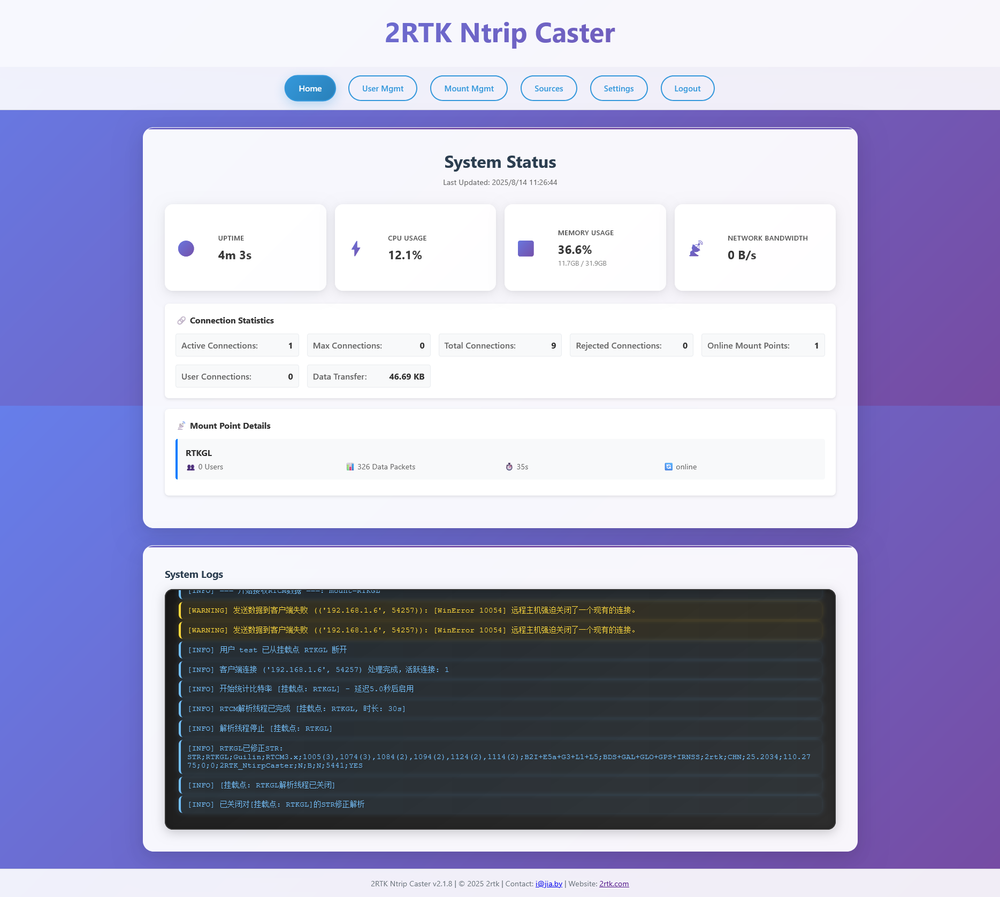
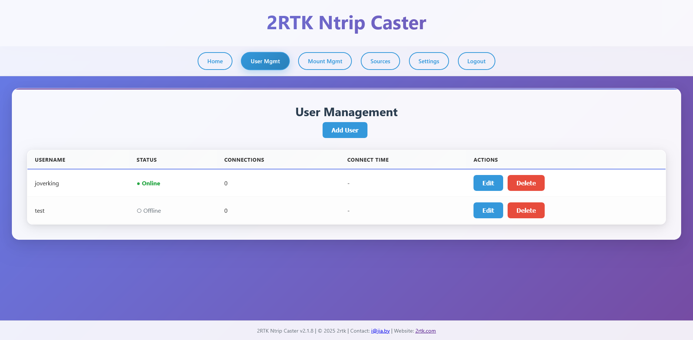
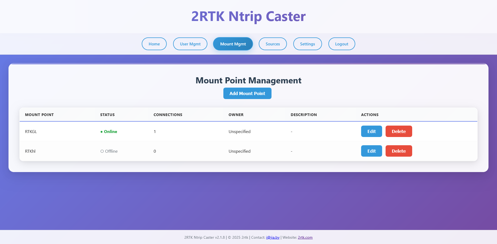
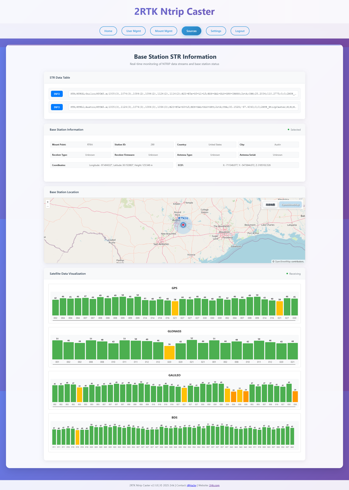

# 2RTK NTRIP Caster v2.3.3

**Language / 语言选择:**
- [English](README.md)
- [中文版](#) (当前)

---

这是一个使用python编写的简易的NTRIP caster，支持NTRIP v1.0和v2.0协议，使用web管理页面管理。
可以使用web在浏览器添加用户和挂载点等信息，也可以在浏览器查看NTRIPcaster的连接信息。
它支持高并发连接，能够处理2000+的并发连接数。（因为我的测试环境有限，所以我只测试了2个RTCM数据源。2000用户并发的数据下载，但是它的性能表现非常好）

它以前是一个单独的文件2rtk.py，我最近重构了它。现在看起来胖了很多.但是我感觉它还是比较轻量级的。lol

- 使用web管理。所以你可以把它部署在任意的云主机上.
- 使用SQLite数据库存储用户信息和挂载点信息.
- 借用了pyrtcm库，会对上传的数据进行解析然后修正STR表（这部分代码重写了几次.但是我总感觉不满意，包括现在的版本.期待后续更新）.
    （你只需要在web页面添加一个挂载点，然后上传RTCM数据，2rtk-NtripCaster会自动生成STR信息.并且会解析RTCM数据从中提取数据类型等位置信息对STR进行修正）
- 这个NTRIP caster和我心中的caster还很远。我会在空闲的时间慢慢去完善它。
- 它支持大多数装有python环境的系统，包括debian、ubuntu、centos、armbian等。
- 支持docker部署。
- Web 界面中英双语，顶栏可一键切换（选择会被记住，也可用 `?lang=zh|en` 强制指定），后端返回的提示语同样会跟着切换。
- 顶栏/页脚的“打赏作者”入口会展示支付宝与微信收款码。

## 安装教程

### 源码安装（tar.gz，最简单）
无需 Docker，任何装有 Python 3.9+ 的 Linux / macOS / Windows 均可。

```bash
# 1. 解压
tar -xzf ntripcaster-full.tar.gz
cd ntripcaster

# 2. 从示例复制出配置文件（然后记得改管理员密码）
cp config.ini.example config.ini

# 3. 安装依赖（推荐用虚拟环境）
python3 -m venv venv
source venv/bin/activate
python3 -m pip install -r requirements.txt

# 4. 启动
python3 main.py
```

- Web 管理界面地址 `http://yourserverip:5757`，默认账号 `admin` / `admin123`（登录后请立即修改）。
- 首次启动时，`secret_key` 留空会自动生成并落盘到 `data/.secret_key`。
- **详细原生安装教程**：[Linux 系统原生安装教程](INSTALL-TUTORIAL.md)

### 一键安装脚本（Debian 11+ / Ubuntu 22.04+，自动装 systemd 服务并开机自启）

> ⚠️ **不支持**：Ubuntu 20.04 和 Debian 10 **无法安装**——它们自带 Python 3.8，而 `pyrtcm==1.1.8` 要求 Python 3.9+。请使用 Debian 11+ / Ubuntu 22.04+（或更新的发行版）。

脚本会自动下载源码、装依赖、建服务，**自动适配网络**（先试 GitCode，失败回退 GitHub，也可用 `REPO_SOURCE` 指定）；**自动切换 pip 国内镜像**加速依赖安装。

> 运行方式：**普通用户**用 `sudo bash install.sh`；**已是 root 登录**的直接用 `bash install.sh`（无需 sudo）。

**中国区服务器**（从 GitCode 拉取）：

```bash
git clone https://gitcode.com/rampump/NTRIPcaster.git && cd NTRIPcaster && sudo bash install.sh
```

**国际服务器**（从 GitHub 拉取）：

```bash
git clone https://github.com/Rampump/NTRIPcaster.git && cd NTRIPcaster && sudo bash install.sh
```

> 脚本会自动检测本地源码、跳过重复下载；如遇网络问题，可加 `REPO_SOURCE=gitcode` 或 `REPO_SOURCE=github` 强制指定源。

### Docker 部署（推荐）
推荐一键部署，无需手动配置。

**中国区服务器**（腾讯云镜像，无需登录、直连快）：

```bash
docker run -d --name ntrip-caster -p 2101:2101 -p 5757:5757 ccr.ccs.tencentyun.com/2rtk/ntripcaster:latest
```

**国际服务器**（Docker Hub 官方镜像）：

```bash
docker run -d --name ntrip-caster -p 2101:2101 -p 5757:5757 2rtk/ntripcaster:latest
```
- **中文教程**: [Docker 安装和使用教程](DOCKER-TUTORIAL.md)
- **English Tutorial**: [Docker Installation and Usage Guide](DOCKER-TUTORIAL-EN.md)

### Debian系统原生安装
- **中文教程**: [Linux 系统原生安装教程](INSTALL-TUTORIAL.md)
- **English Tutorial**: [Linux Native Installation Guide](INSTALL-TUTORIAL-EN.md)

**访问地址**:
-  Web管理界面: `http://yourserverip:5757`
-  NTRIP服务: `ntrip://yourserverip:2101`
-  默认账号: `admin` / `admin123` (记得修改默认密码)

## 更新升级（保留数据，一键无损）

`update.sh` 会自动识别部署形态（源码+systemd / Docker），更新前备份配置与数据库，
更新后做健康检查，失败自动回滚。**用户数据、挂载点配置、数据库全部保留。**

升级前脚本会**先检查本机旧版本是否正在运行，在运行就先停掉它再动文件**：

1. 按 systemd 单元内容反查所有指向 `/opt/2rtk` 的服务（默认 `2rtk.service`，服务名被改过也能找到），
   并锁定「正在运行的那个」作为实际服务名，后续停止 / 启动 / 诊断 / 服务文件同步都用它；
2. `systemctl stop` 停止服务，超过 25 秒不退则 `SIGKILL`，并 `reset-failed` 清掉失败计数；
3. 清理不受 systemd 托管的手工启动进程（`python main.py` 之类）；
4. 确认 2101 / 5757 端口真正释放后才开始替换代码。

没有 systemd 的机器（只有 `/etc/init.d` 脚本）会自动改用 `service <name> stop/start`，
两者都没有时按安装脚本同款命令直接拉起，不会去调用不存在的 `systemctl`。

Docker 形态同理，**必须先停容器、再删容器、最后才创建新容器**：

1. 从容器 label 读出 compose 归属（项目名 / 服务名 / 工作目录 / 配置文件），没有 label 说明是 `docker run` 创建的；
2. 读取容器的端口、卷、环境变量、重启策略，生成 `recreate_container.sh`（回滚复用）；
3. `docker compose stop` / `docker stop` 停旧容器 → `docker rm -f` 删除 → 再 `up -d --force-recreate` 或按原参数 `docker run`；
4. 把拉取到的新镜像标记成 compose 里写的镜像名（如 `ntripcaster:2.3.1`），否则 compose 会继续用本地旧镜像；
5. 健康检查失败自动用旧镜像重建容器。

不删容器直接 `up` 的后果是 `container name is already in use`，或旧容器不退导致 2101/5757 一直被占。

这样新版本启动时不会因端口被旧实例占用而失败，避免出现「服务重启后未正常运行」。

### 推荐方式：在项目源码目录执行

```bash
# 进入你当初 git clone 的目录（注意：不是 /opt/2rtk）
cd ~/NTRIPcaster
git pull                      # 先拿到最新版 update.sh 本身
sudo bash update.sh           # 自动检测源并更新
```

### 强制更新 / 指定更新源

```bash
sudo bash update.sh --force                # 跳过版本比对，强制更新
sudo REPO_SOURCE=github bash update.sh     # 源码形态：指定 GitHub 源
sudo REPO_SOURCE=gitcode bash update.sh    # 源码形态：指定 GitCode 源
sudo REPO_SOURCE=tcr bash update.sh        # Docker 形态：指定腾讯云镜像源
```

### 没有保留源码目录怎么办

`/opt/2rtk/update.sh` 是**安装时复制进去的旧副本，不会自动变新**。先拉一份最新脚本再执行：

```bash
cd /tmp && rm -rf _2rtk_upd
git clone --depth 1 https://gitcode.com/rampump/NTRIPcaster.git _2rtk_upd
sudo bash _2rtk_upd/update.sh        # 可直接在 /tmp 目录下运行，脚本使用绝对路径
rm -rf /tmp/_2rtk_upd
```

> 更新完成后建议检查服务状态：`systemctl status 2rtk`，日志：`journalctl -u 2rtk -n 50`

## 硬件推荐

### 最低配置要求
- **CPU**: 2核心 (推荐 x86_64 架构)
- **内存**: 2GB RAM
- **存储**: 10GB 可用磁盘空间
- **网络**: 稳定的网络连接
- **操作系统**: Ubuntu 22.04+ / Debian 11+ / CentOS 8+（需 Python 3.9+，不支持 Ubuntu 20.04 / Debian 10）

## 前端Web界面功能
### 首页
你可以在首页看到当前caster的运行状态，包括连接数、用户数、挂载点数等。以及下方的日志信息会实时推送用户或者挂载点的连接情况。DEBUG模式会推送更多的调试信息。



### 用户管理页面
你可以在用户管理页面添加用户，删除用户，修改用户密码等。也可以看到在线的用户。（后期会添加对用户的管理，API已预留）



### 挂载点管理页面
你可以在挂载点管理页面添加挂载点，删除挂载点，修改挂载点信息等。也可以看到在线信息。（后期添加挂载点管理，API已预留）



### 基准站信息页面
你可以在基准站信息页面查看RTCM情况，点击STR条目前INFO按钮，后台会对其进行解析，然后显示在下方的信息中。（这通常需要一点时间解析才会更新显示）



### 不同负载下的配置建议

| 并发连接数 | CPU | 内存 | 存储 | 网络带宽 |
|-----------|-----|------|------|----------|
| **< 100** | 1核心 | 1GB | 5GB | 10Mbps |
| **100-500** | 2核心 | 2GB | 10GB | 50Mbps |
| **500-1000** | 4核心 | 4GB | 20GB | 100Mbps |
| **1000-2000** | 8核心 | 8GB | 50GB | 200Mbps |
| **2000+** | 16核心+ | 16GB+ | 100GB+ | 500Mbps+ |

### 云服务器推荐
云服务器部署请在安全设置中开启5757和2101端口
#### AWS EC2
- **入门型**: t3.small (2核2GB)
- **标准型**: c5.large (2核4GB)
- **高性能**: c5.2xlarge (8核16GB)

## 性能基准测试

- **500连接测试**: CPU 18.1%, 内存 29.5%, 网络 7.47 Mbps
- **1000连接测试**: CPU 19.1%, 内存 33.9%, 网络 10.79 Mbps  
- **2000连接极限测试**: CPU 17.3%, 内存 30.3%, 网络 7.69 Mbps

> 详细测试报告请查看 [tests/](tests/) 目录

## 配置指南

### 主要配置选项

```ini
[ntrip]
port = 2101                        # NTRIP服务端口
max_connections = 5000             # 最大连接数（在 [network] 段）
download_enforce_user_binding = false  # 拉流是否强制校验挂载点与用户的绑定关系

[web]
port = 5757                        # Web管理端口
realtime_push_interval = 3         # 实时数据推送间隔

[database]
path = 2rtk.db                     # SQLite 路径，容器内请用 /app/data/2rtk.db
pool_size = 10                     # 连接池容量

[data_forwarding]
ring_buffer_size = 60              # 环形缓冲保留秒数
ring_buffer_max_chunks = 3000      # 单挂载点最大缓存块数
sender_threads = 8                 # 发送线程数
client_send_queue_size = 200       # 单客户端待发队列上限（块）
client_pending_max_bytes = 1048576 # 单客户端积压字节上限

[performance]
thread_pool_size = 5000            # 并发连接线程池大小

[security]
secret_key =                       # 留空则自动生成并落盘到 data/.secret_key
login_max_attempts = 5             # 登录失败次数上限
login_lockout_seconds = 300        # 锁定时长

[admin]
username = admin                   # 管理员用户名
password = admin123                # 管理员密码（生产环境请修改）
```

### 安全说明（重要）

- **认证方式只有 HTTP Basic，Digest 已从代码中彻底移除**。NTRIP 1.0 用挂载点口令，
  NTRIP 2.0 用用户账号口令。原因：仓库原实现的 Digest 从未生效（nonce 不校验，
  且库里只有 PBKDF2 哈希、算不出客户端期望的 HA1），修好校验反而会引入重放面。
  现在收到 Digest 请求会直接返回 401 并只宣告 Basic，客户端需改配置。
- **挂载点口令与用户口令都以 PBKDF2 入库**，管理端只能重置、不能回读；
  接口返回的是掩码。历史明文数据在下次修改口令时自动迁移。
- **`/classic` 页面已下线**，访问会 302 跳转到新版单页管理端。
- **`config.ini` 不再纳入版本库**（含密钥与管理员口令）。首次部署请
  `cp config.ini.example config.ini` 后再改。
- 反向代理部署时把 `[security] trust_proxy_headers` 打开，HTTPS 下同时打开
  `session_cookie_secure`。

### 常见问题诊断

#### 端口占用问题
```bash
# 检查端口占用
sudo ss -tlnp | grep :2101    # NTRIP端口
sudo ss -tlnp | grep :5757    # Web管理端口
sudo lsof -i :2101                 # 查看端口使用情况

# 释放端口
sudo kill -9 <PID>                 # 强制结束进程
sudo fuser -k 2101/tcp             # 强制释放端口
```

#### 网络连接问题
```bash
# 防火墙检查
sudo ufw status                    # Ubuntu防火墙
sudo firewall-cmd --list-all       # CentOS防火墙

# 开放端口
sudo ufw allow 2101/tcp            # NTRIP端口
sudo ufw allow 5757/tcp            # Web管理端口

# 网络连通性测试
telnet localhost 2101              # 测试NTRIP端口
curl http://localhost:5757/        # 测试Web端口
```

#### 服务启动失败
```bash
# 检查服务状态
sudo systemctl status 2rtk

# 查看详细日志
sudo journalctl -u 2rtk -f

# 检查配置文件
python3 -c "import configparser; c=configparser.ConfigParser(); c.read('config.ini'); print('配置文件语法正确')"

# 检查端口权限
sudo ss -tlnp | grep :2101
```

#### 数据库问题
```bash
# 检查数据库文件权限
ls -la data/2rtk.db

# 重建数据库（谨慎操作）
rm data/2rtk.db
python3 main.py  # 会自动创建新数据库
```

#### 内存使用过高
```bash
# 监控内存使用
top -p $(pgrep -f "python.*main.py")

# 调整配置降低内存使用
# 在config.ini中减少以下参数：
# max_connections = 1000
# thread_pool_size = 1000
# ring_buffer_size = 30
```

### 性能优化

#### 高并发配置
```ini
# config.ini 优化配置
[network]
max_connections = 10000            # 最大连接数

[ntrip]
port = 2101

[performance]
thread_pool_size = 10000           # 线程池大小
max_workers = 10000                # 最大工作线程

[data_forwarding]
ring_buffer_size = 60              # 环形缓冲区
```

### 监控和日志

#### 日志级别配置
```ini
# config.ini 日志配置
[logging]
log_level = WARNING                # DEBUG, INFO, WARNING, ERROR
log_format = %%(asctime)s - %%(name)s - %%(levelname)s - %%(message)s
max_log_size = 10485760            # 日志轮转大小（字节）
backup_count = 5                   # 保留日志文件数
```

## 版本管理

版本号只有一个源头：仓库根目录的 `VERSION` 文件（单行，如 `2.3.1`）。
其余所有位置（示例配置、compose、Dockerfile、部署脚本、文档、前端页脚）都是**派生副本**，由脚本自动刷新。

发版只需两步：

```bash
echo "2.3.2" > VERSION            # 1. 只改这一处
python3 scripts/sync_version.py   # 2. 全局自动对齐
```

校验（不一致退出码为 1，可直接用于 CI）：

```bash
python3 scripts/sync_version.py --check
```

运行期取值优先级：`VERSION` 文件 > 环境变量 `APP_VERSION` > `config.ini` 的 `[app] version`。
因此升级后前端页脚、`/health` 接口和 NTRIP 响应头里的 `Server:` 版本号始终与实际构建一致，
不会再出现「配置文件还是旧版本号」的错位。

> 注意：教程末尾的历史更新日志（形如 `- **v2.3.0**: ...`）属于变更记录，同步脚本不会改动。

## 贡献

- 欢迎提交 Pull Request
- 联系方式: i@jia.im
- 官方网站: https://2rtk.com

## 致谢与开源库

本项目使用了以下优秀的开源库和工具，在此表示诚挚的感谢：

### 核心依赖

| 库 | 版本 | 用途 | 许可证 |
|----|------|------|--------|
| **Flask** | 3.0.3 | Web框架，提供HTTP服务和API | BSD-3-Clause |
| **Flask-SocketIO** | 5.3.6 | WebSocket实时通信支持 | MIT |
| **python-socketio** | 5.8.0 | Socket.IO协议实现 | MIT |
| **psutil** | 5.9.5 | 系统性能监控和资源统计 | BSD-3-Clause |
| **pyrtcm** | 1.1.8 | RTCM 3.x消息解析（支持MSM消息） | BSD-3-Clause |
| **pyproj** | 3.5.0 | 地理坐标系统转换和投影计算 | MIT |
| **reverse-geocode** | 1.6.6 | 离线反向地理编码（STR位置信息） | MIT |

### RTCM解析库

**pyrtcm** - 核心RTCM消息解析库
- **来源**: 通过 pip 安装的标准 [pyrtcm](https://github.com/semuconsulting/pyrtcm) 包
- **版本**: 1.1.8（锁定版本，保证构建可复现）
- **作者**: semuconsulting
- **许可证**: BSD-3-Clause
- **用途**: 提供完整的RTCM 3.x消息解析（GPS/GLONASS/Galileo/北斗的 MSM4/5/7）
- **说明**: 为确保项目稳定性，建议直接将pyrtcm库源码集成到项目中，避免外部依赖风险

## 开源许可证

本项目采用 [Apache License 2.0](LICENSE) 许可证。

### 第三方库许可证

- **pyrtcm**: BSD-3-Clause 许可证
- **Flask系列**: MIT/BSD 许可证  
- **psutil**: BSD-3-Clause 许可证
- **pyproj**: MIT 许可证

所有集成的第三方库均保持其原有的开源许可证。使用时请遵守相应的许可证条款。

---

**如果这个项目对您有帮助，请给我一个 Star！**